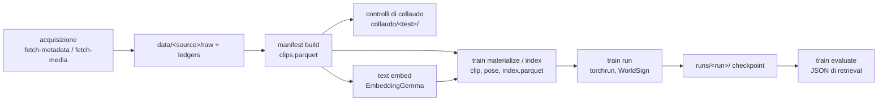

# Architettura

Dettagli del modello: `docs/worldsign-architettura.md`, loss `docs/worldsign-loss.md`, addestramento per livello `docs/worldsign-gerarchia.md`, ablation `docs/worldsign-ablation.md`.

## Diagramma del sistema

## Flusso della pipeline

1. `fetch-metadata` / `fetch-media` scaricano una source in `data/<source>/`; gli esiti vanno nei ledger per shard (riprendibili).
2. `manifest build` normalizza ogni source in un unico manifest di clip.
3. `check …` / `text verify` eseguono i controlli di collaudo e scrivono report JSON.
4. `text embed` precalcola gli embedding delle didascalie (EmbeddingGemma-300M congelato).
5. `train materialize` + `train index` tagliano le clip, estraggono le pose, costruiscono l'indice di addestramento.
6. `train run` addestra WorldSign con overlay di configurazione (`worldsign.yaml` + braccio di ablation + overlay dei dati).
7. `train evaluate` calcola le metriche di retrieval su uno split.

## Componenti

- **`signworld/cli`** — app Typer; wrapper sottili dei comandi con import pesanti differiti. Non contiene logica.
- **`signworld/data/acquisition`** — adattatori delle source (`sources/`), trasferimento, ledger, sharding, gestione di pacing/rifiuti, provenienza. Non tocca il codice del modello.
- **`signworld/data/corpus`** — manifest, parsing di VTT/didascalie, lingue, materialize (taglio delle clip). Possiede `clips.parquet`.
- **`signworld/data/pose`** — stima della posa wholebody con RTMLib, box, scheletro/token.
- **`signworld/data` (livello superiore)** — loader, campionamento, negativi, augmentation, testo, dati sintetici toyworld.
- **`signworld/models/worldsign`** — il modello: ramo video (V-JEPA 2.1 + LoRA), fusione, predictor fisico, encoder di posa, predictor semantico, ramo testuale, lettura. `encoders/` incapsula teacher ed encoder preaddestrati; `sjepa/` è la baseline di posa S-JEPA.
- **`signworld/loss`** — loss di WorldSign e SIGReg.
- **`signworld/metrics`** — retrieval, geometria, isotropia, probe.
- **`signworld/experiment`** — `train/` (trainer, distribuito, curriculum, checkpoint, preflight), `evaluation/`, controlli di `collaudo/`, esperimenti preliminari in `studies/`.
- **`signworld/logger`** — mirror W&B offline opzionale.
